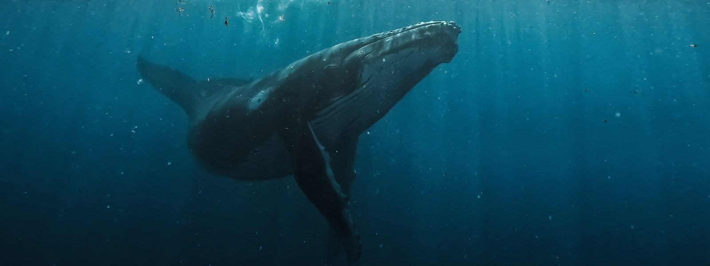

# LEE SAEWA

**UI Developer & Design Engineer** — a designer-turned frontend engineer, building UI that lasts.

**KR** 디자이너 출신 프론트엔드 개발자입니다. 화면 너머의 구조까지 설계해, 다음 변경에도 버티는 UI를 만듭니다. 
**EN** A designer-turned frontend engineer with 10 years in UI. I design the structure behind the screen so the UI survives the next change. 
**JP** デザイナー出身のフロントエンドエンジニアです。画面の裏側の構造まで設計し、次の変更にも耐えられるUIをつくります。

**[→ Portfolio](https://saewa-portfolio.vercel.app/)** · **[✉ saewa0424@gmail.com](mailto:saewa0424@gmail.com)**

---

## 🌊 Featured — Portfolio 2026

**[Live site](https://saewa-portfolio.vercel.app/)** · **[Source](https://github.com/leesaewa/saewa_portfolio)**

`React 19` `TypeScript` `GSAP` `ScrollTrigger` `Lenis` `Tailwind CSS v4` `Vite`

- Scroll-driven motion built only with free GSAP — per-character blur-in titles, a stacked work-card scroll, and SVG wave lines animated through path attributes
- Trilingual (ko / en / ja) through a custom i18n context, with every visible string typed and translated
- Semantic landmarks, keyboard focus states, and screen-reader labels, following WCAG 2.1 AA

## Selected Work

| Project | What I did | Stack |
| --- | --- | --- |
| **NDR Security Analytics**  Sands Lab · Lead FE | AI anomaly and asset-threat dashboards, a resizable multi-window modal system, and a shared ag-Grid table | Vue 3, ECharts, Three.js, Storybook |
| **Cloud Security SaaS for Japan's SMB market**  Sands Lab · Lead FE | Threat dashboards, 3D threat visualization, PDF reports, and ko / en / ja i18n for the Japan launch | Vue 3, SCSS, ECharts, Three.js |
| **The Daily Prophet SNS**  Side project · Solo | A newspaper-style SNS for writing and sharing article posts · [Live](https://nwitter-reloaded-c85df.web.app) · [Code](https://github.com/leesaewa/nwitter) | React, TypeScript, Firebase |
| **MARAUTUBE**  Side project · Solo | A video platform with uploads, live streaming, and comments · [Live](https://wetube-reloaded-production-bdcc.up.railway.app/) · [Code](https://github.com/leesaewa/wetube-reloaded) | Node.js, Express, MongoDB |

## Experience

| Period | Company | Role | Highlights |
| --- | --- | --- | --- |
| 2023 — now | Sands Lab. | Frontend Engineer | Vue 3 security products, ECharts node-layout algorithm, Vue 2 legacy refactor, Docker / Nginx deployment |
| 2022 | Smartnow | UI Developer & Designer | Game-community app UI and landing page renewal |
| 2018 — 2021 | Brangista. | UI Developer & Designer | **Japanese e-commerce** builds and operation on Rakuten, Yahoo! Shopping, EC-CUBE, and MakeShop · adidas landing pages · trained the design teams in Osaka and Taiwan |
| 2015 — 2017 | Web agencies | UI Developer & Designer | Responsive publishing, cross-browsing, and accessibility |

## Stack

  

Also: GSAP · Storybook · ECharts · Three.js · ag-Grid · Zustand · TanStack Query · i18n · Web accessibility

---

🐋 Off-screen, I love orcas, dolphins, whales, and polar bears, which is why the portfolio lives in a deep ocean.
